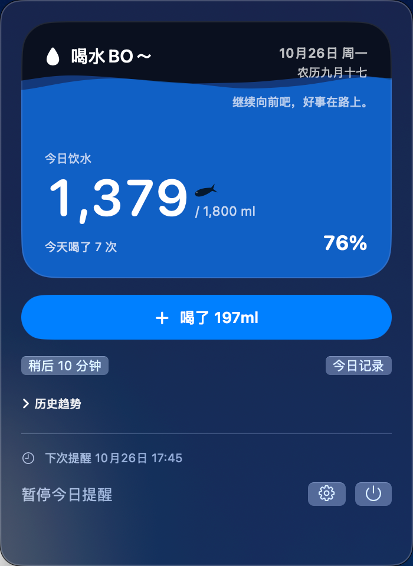

# 喝水BO～



这是我给自己做的一个 macOS 菜单栏喝水提醒。起因很简单，我忙起来经常忘记喝水，又不想为了记一杯水打开一个很重的软件，所以把它放在了菜单栏里。到时间提醒一下，喝完点一下，今天喝了多少就记下来了。

整张蓝色卡片就是今天的水量。喝得越多，水面升得越高，菜单栏上的水滴也会直接显示完成百分比。默认目标是 1800ml，每次 197ml，这两个数字都可以按自己的杯子来改。

## 我放进去的一些小心思

水位到 30% 后，会有小鱼在里面慢慢游。它有时快一点，有时慢一点，偶尔停下来休息，也会凑过去啄一下数字。点一下水面，它会慢慢游向你点的位置；连续点三下，它会跃出水面，再带着一点水花落回去。平时它也可能自己跳出来，只是次数很少。

喝到 60%、80% 和 100% 时，会有一次比一次热烈的彩带。水波的颜色、透明度、起伏和速度也都能自己调。如果系统开启了“减少动态效果”，这些动画会自动安静下来。

## 能做什么

- 常驻菜单栏，通过系统通知提醒喝水。
- 自定义每日目标、每次杯量和稍后提醒时间。
- 工作日和周末可以使用不同的提醒时段与间隔。
- 查看当天每次喝水的时间，记错了可以撤销。
- 用日、周、月、年热力格回看喝水情况。
- 按任意日期范围导出 CSV，保留每次喝水的时间和水量。
- 达到当天目标后自动停止提醒，也可以关闭这个选项。
- 可选配 iPhone 快捷指令，用 `197ml／自定义水量` 两种方式快速记录，并通过自己的 iCloud Drive 同步回 Mac。

## 关于隐私

它不需要开发者账号，也不收集任何用户信息。默认情况下记录只保存在自己的 Mac 上；只有主动打开 iCloud 同步时，饮水记录才会进入你自己的 iCloud Drive，不经过第三方服务器。安装包、快捷指令和这个仓库里都没有我的个人记录。

第一次使用时，可以先量一下常用杯子装多少水，再把“每次记录”改成这个数。以后每喝完一杯点一下，会比凭感觉估算准很多。

支持 macOS 13 Ventura 或更新版本，Apple 芯片和 Intel 芯片都可以构建。

## 使用提醒

首次打开后点击菜单栏水滴，再点击“开启通知”。也可以在设置里发送一条测试通知。系统专注模式及通知设置可能影响横幅、声音和按钮显示。菜单栏应用不会出现在 Dock 里。

数据保存在 `~/Library/Application Support/com.bobo.WaterReminder/state.json`，按本地日期统计，不会自动删除历史记录。应用退出或电脑睡眠时不发送提醒，重新打开或唤醒后继续。当前工作日按周一至周五计算，不识别法定节假日调休；提醒时段暂不支持跨午夜。

iPhone 快捷指令的安装与隐私说明见 [docs/iphone-shortcut/README.md](docs/iphone-shortcut/README.md)。

## 构建

需要 Swift 6 命令行工具，零外部依赖。

```sh
swift run WaterCoreChecks
./script/build_and_run.sh --verify
```

应用位于 `dist/喝水BO～.app`。可放到“应用程序”后使用；开启自动启动前请先确定最终存放位置。本机使用临时签名，未进行 Developer ID 公证。水滴图标基于 macOS 系统符号生成，重建命令：`swift script/make_icon.swift Resources/AppIcon.iconset`，然后运行 `iconutil -c icns Resources/AppIcon.iconset -o Resources/AppIcon.icns`。

## Intel Mac 版本

运行 `bash script/build_intel.sh` 交叉编译 x86_64 Release 版本。应用位于 `dist/intel/喝水BO～.app`，传输包为 `dist/喝水BO～-Intel.zip`。要求 macOS 13 Ventura 或更新版本。独立打包，不覆盖当前 Apple 芯片版本；Intel 核心逻辑已在 Rosetta 下验证，界面与通知仍需在 Intel 实机确认。
