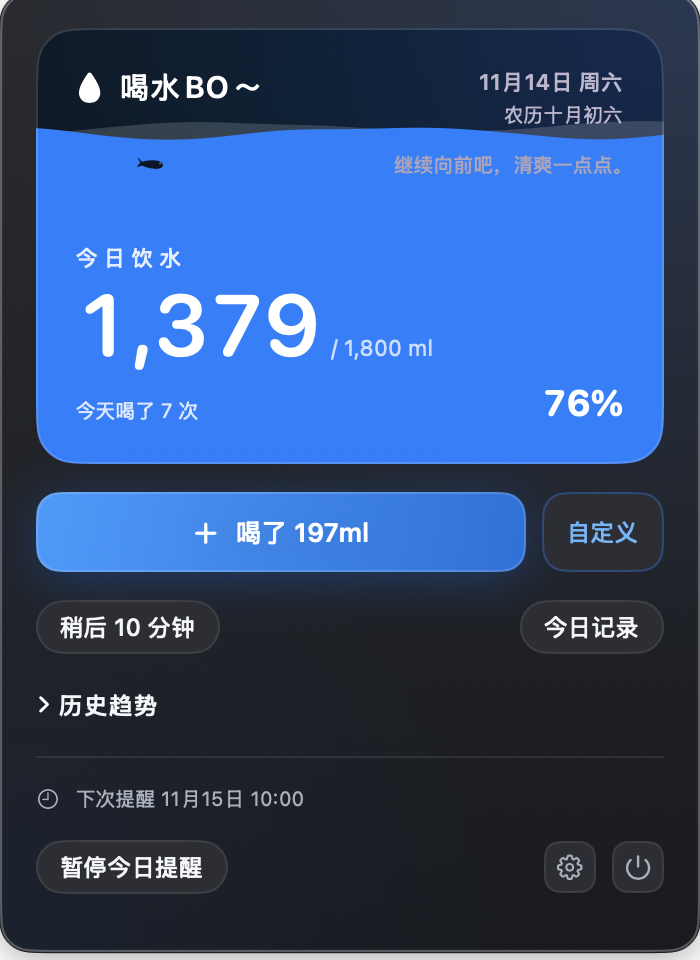
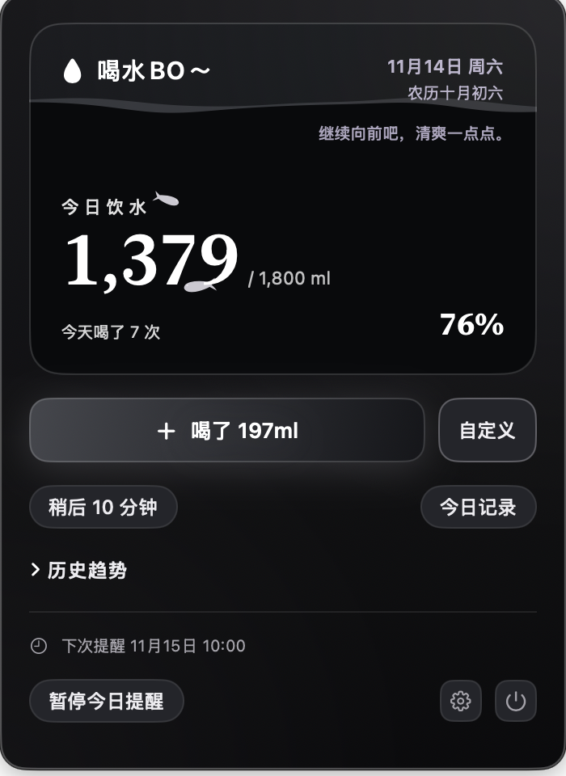
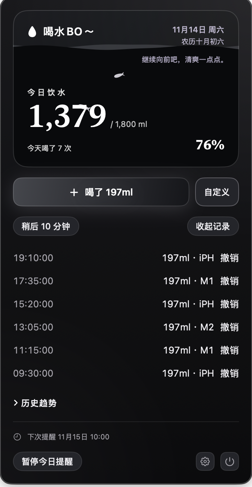
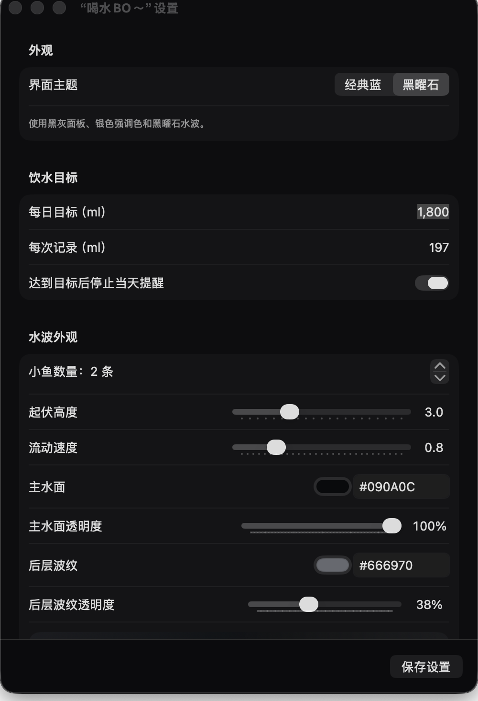
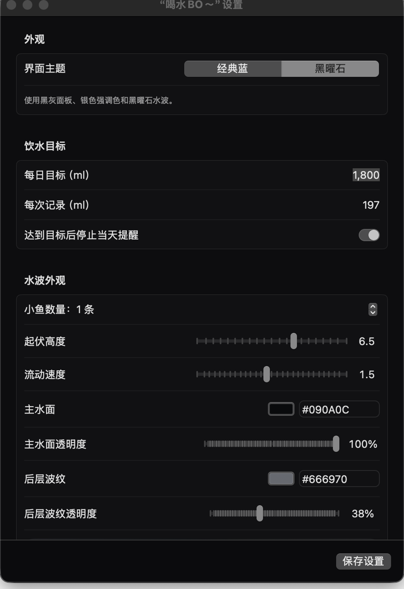

# 喝水BO～



一个常驻 macOS 菜单栏的喝水提醒工具。到时间提醒一下，喝完点一下，今天喝了多少就记下来。

它不要求注册，不收集用户数据。记录默认只保存在本机；主动开启 iPhone 同步后，也只经过你自己的 iCloud Drive，以及同一 Wi‑Fi 下的局域网直连。

当前版本：`1.2.2` · 支持 macOS 13 Ventura 或更新版本 · Apple 芯片与 Intel Mac 均可使用

## 现在长这样

整张蓝色卡片就是今天的水量。喝得越多，水面升得越高；菜单栏上的水滴会同步显示完成百分比。默认目标是 `1800ml`，每次记录 `197ml`，都可以按自己的杯子修改。

全新安装会在欢迎页提供“发送最新快捷指令”。Mac 和 iPhone 登录同一个 Apple ID，发送一次快捷指令文件，之后不用在 Mac 前，也能随手记录喝水。

## 黑曜石主题

除了默认的经典蓝，还可以在“设置 → 外观 → 界面主题”切换到黑曜石。它使用黑灰面板、银色强调色和深色水波；切换主题时，水波会套用对应的默认配色，之后仍可以继续单独调整颜色、透明度、起伏和速度。下面的截图均来自 1.2.1 的黑曜石主题。



展开“今日记录”后，可以看到每次喝水的时间、水量和来源设备。这里的 `iPH` 是 iPhone，`M1`、`M2` 是不同的 Mac；记录记错时可以逐条撤销。



黑曜石主题下的设置页也会同步切换面板和强调色。小鱼数量、水波色值、透明度与动态效果都可以在这里调整。



## 能做什么

- 常驻菜单栏，通过系统通知提醒喝水，支持“已喝水”和“稍后提醒”操作。
- 自定义每日目标、每次记录杯量、稍后提醒时间，以及工作日与周末各自的提醒时段。
- 除了默认杯量，也可以直接记录自定义水量。
- 查看当天的逐次记录；记错了可以撤销，并用日、周、月、年热力格回看趋势。
- 按任意日期范围导出 CSV，保留时间、水量、来源设备和次数。
- 达到当天目标后自动停止提醒，也可以关闭这个选项。
- 可选配 iPhone 快捷指令，用 `197ml／自定义水量／查看今日记录` 三种操作完成日常使用。
- 同一 Wi‑Fi 下优先通过局域网把手机记录发给 Mac，通常一两秒内更新；局域网不可用时仍由 iCloud 补齐。
- 多台 Mac 可以同时记录，历史里用 `M1`、`M2`、`iPH` 区分来源；电脑后缀可以改成 `OFFICE`、`HOME` 或 `MBP`。
- 支持经典蓝与黑曜石两种界面主题，并可调整小鱼数量、水波颜色、透明度、起伏和流动速度。
- 可选“登录时自动启动”，重启电脑后不用再手动打开。

## 小鱼与水面

水位到 30% 后，会有小鱼在水里慢慢游。它有时快一点，有时慢一点，偶尔停下来休息，也会凑过去啄一下数字。点一下水面，它会慢慢游向你点的位置；连续点三下，它会跃出水面，再带着一点水花落回去。平时它也可能自己跳出来，只是次数很少。

喝到 60%、80% 和 100% 时，会有一次比一次热烈的彩带。水波的颜色、透明度、起伏和速度也都能自己调。如果系统开启了“减少动态效果”，这些动画会自动安静下来。

## iPhone 与多台 Mac 怎么同步

iPhone 快捷指令把每次喝水保存成一条独立事件，Mac 会按记录 ID 合并，重复到达的同一杯只计算一次。

1. 在同一 Wi‑Fi 下，快捷指令会先寻找可用的 Mac，直接发送喝水事件。
2. 局域网不可用时，事件仍会保存在你自己的 iCloud Drive，等网络恢复后由 Mac 补齐。
3. 多台 Mac 各自发布设备地址，记录会带上电脑后缀；手机记录统一显示为 `iPH`。
4. Mac 端负责汇总每日目标、完成百分比和剩余水量，iPhone 打开快捷指令时可以直接查看最新进度。



设置页可以修改目标、杯量、提醒规则、主题和水波外观。开启同步后，还能分别控制 iCloud、同一 Wi‑Fi 加速、优先接收设备和这台电脑的短后缀。

## 快速开始

1. Mac App 不会出现在 Dock 里。打开后看屏幕顶部的菜单栏，点击水滴图标开始使用。
2. 全新安装默认开启 iCloud 同步与局域网加速。在欢迎页点“发送最新快捷指令”，把随 App 提供的文件发送到 iPhone 并打开。
3. 第一次运行时，iOS 会询问是否允许快捷指令访问 iCloud 中的「快捷指令」文件夹，点“始终允许”。它只用于读写喝水记录。
4. 同一 Wi‑Fi 下首次使用，macOS 还可能询问是否允许局域网访问。允许后手机记录才能走快速通道；拒绝也不影响 iCloud 同步。
5. 点击菜单栏水滴，可以开启通知、记录喝水、查看今天喝了几次、暂停提醒或进入设置。

给朋友安装时，可以直接发送[安装与使用说明](docs/安装与使用说明.txt)。Apple 芯片和 Intel 芯片各有一个 DMG，安装时按电脑芯片选择。

## 数据与隐私

它不需要注册，也不收集任何用户信息。默认情况下记录只保存在自己的 Mac 上；只有主动开启 iCloud 同步时，饮水记录才会进入你自己的 iCloud Drive。

局域网加速只在同一 Wi‑Fi 内使用，不开公网端口，也不经过第三方服务器。安装包、快捷指令和这个仓库里都没有个人饮水记录。

数据保存在 `~/Library/Application Support/com.bobo.WaterReminder/state.json`，按本地日期统计，不会自动删除历史记录。应用退出或电脑睡眠时不发送提醒，重新打开或唤醒后继续。

当前工作日按周一至周五计算，不识别法定节假日调休；提醒时段暂不支持跨午夜。多台 Mac 同时记录时，每次真实点击都会保留；同一条手机事件通过局域网和 iCloud 到达两次只算一次。

## 使用提醒

点击菜单栏水滴后可以开启通知，也可以在设置里发送一条测试通知。系统专注模式及通知设置可能影响横幅、声音和按钮显示。

Mac 旧版本升级时仍会保留原来的同步开关，不会自动上传已有本地记录。全新安装则默认开启 iCloud 同步和局域网加速。

iPhone 快捷指令的详细说明见 [docs/iphone-shortcut/README.md](docs/iphone-shortcut/README.md)。也可以通过[这个 iCloud 链接](https://www.icloud.com/shortcuts/ff34db7a41f04ca9955fe4f678e4d1d2)添加。Mac 应用和快捷指令请成对更新，旧版快捷指令可能重复统计、覆盖待同步水量或写入空记录。

## 当前版本更新

`1.2.2` 调整了 iPhone 快捷指令的执行顺序：菜单立即出现，喝水记录先完成局域网同步，再显示一次不阻塞的进度通知，不再要求关闭结果页后才发送到电脑。Mac 提醒也会在 3 秒后自动从通知中心移除。

手机端需要安装同一版本随附的快捷指令。README 中的界面截图来自 1.2.1。

## 构建

需要 Swift 6 命令行工具，零外部依赖。

```sh
swift run WaterCoreChecks
./script/build_and_run.sh --verify
bash script/build_release.sh
```

应用位于 `dist/喝水BO～.app`，发布包和两种芯片的 DMG 位于 `dist/` 与 `dist/分享给朋友/`。可放到“应用程序”后使用；开启自动启动前请先确定最终存放位置。本机使用临时签名，未进行 Developer ID 公证。

水滴图标基于 macOS 系统符号生成，重建命令：

```sh
swift script/make_icon.swift Resources/AppIcon.iconset
iconutil -c icns Resources/AppIcon.iconset -o Resources/AppIcon.icns
```

快捷指令源码位于 `docs/iphone-shortcut/喝水BO～.cherri`，编译前检查生成的数据流：

```sh
cherri "docs/iphone-shortcut/喝水BO～.cherri" --skip-sign
python3 scripts/patch_shortcut_event_save.py "docs/iphone-shortcut/喝水BO～_unsigned.shortcut"
bash Tests/ShortcutTests/validate_shortcut.sh "docs/iphone-shortcut/喝水BO～_unsigned.shortcut"
cherri "docs/iphone-shortcut/喝水BO～.cherri" --share=anyone --hubsign
```

## Intel Mac 版本

运行 `bash script/build_intel.sh` 交叉编译 x86_64 Release 版本。应用位于 `dist/intel/喝水BO～.app`，DMG 为 `dist/喝水BO～-Intel.dmg`。

要求 macOS 13 Ventura 或更新版本。Intel 版本独立打包，不覆盖 Apple 芯片版本；Intel 核心逻辑已在 Rosetta 下验证，界面与通知仍建议在 Intel 实机上确认。
