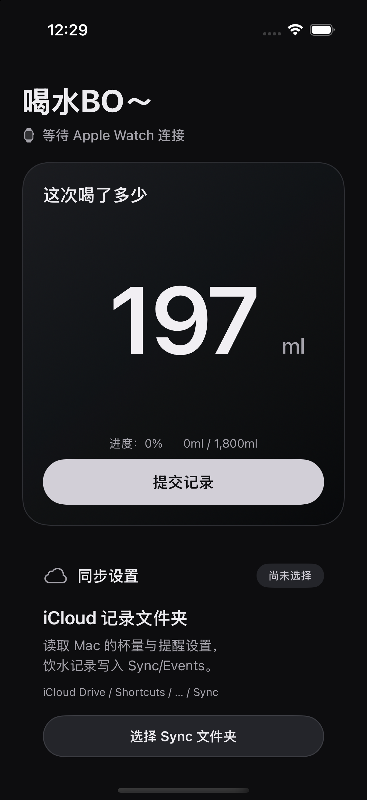
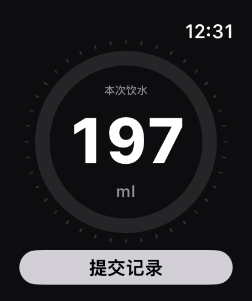

# 喝水BO～ 私人配套 App

这个目录包含一个不上架 App Store 的 iPhone + Apple Watch 配套 App。手表通过 WatchConnectivity 把水量交给 iPhone，iPhone 读取 Mac 的杯量和提醒设置，并把事件写入现有快捷指令的 iCloud `Sync/Events` 文件夹。

不需要手机号、短信、消息自动化或快捷指令嵌套调用。




## 安装

1. 用 Xcode 打开 `WaterCompanion.xcodeproj`。
2. 分别选中 `WaterCompanion` 和 `WaterCompanion Watch App`，在 Signing & Capabilities 里选择自己的 Personal Team。
3. 连接并解锁 iPhone，选择 iPhone 作为运行设备，运行 `WaterCompanion`。
4. 在 iPhone 上打开 App，点“选择 Sync 文件夹”。
5. 在文件选择器里进入：

   `iCloud Drive/Shortcuts/喝水BO～/Sync`

6. 确认 Apple Watch 已与 iPhone 配对。Watch App 会随 iPhone App 一起安装；也可以在 Xcode 中单独选择 Apple Watch 运行。
7. 第一次选择文件夹后允许通知，App 会按 Mac 的工作日、周末、开始时间、结束时间和间隔安排提醒。

App 不会提交到 App Store 或 TestFlight。免费个人签名可能需要定期重新安装。

## 使用

- 手机和手表中央的数字都默认使用 Mac 设置的杯量，是本次要记录的水量。
- 手机和手表都点击数字直接输入；默认值读取 Mac 设置。
- 手机卡片显示 Mac 同步来的今日进度与目标。
- 提交后按钮原位短暂显示勾选和“已保存/已记录”，不弹窗、不需要再次确认。
- 手表外圈圆环只显示今日累计水量与每日目标的完成进度，不随本次数字变化。
- 点“记录”后，手表先通过蓝牙/Wi‑Fi 把事件交给 iPhone。
- iPhone 收到后写入所选 iCloud `Events` 文件夹。
- Mac 的“喝水BO～”会按现有同步循环读取并合并，历史里显示 `WCH`。
- iPhone 暂时不可达时，WatchConnectivity 会排队；iCloud 暂时不可写时，事件保留在 iPhone 本地队列。
- 喝水提醒会显示“记录默认杯量”动作；点通知或这个动作一次，就直接记录 Mac 设置的默认水量，不需要进入 App 再确认。

## 验证

共享层测试：

```sh
DEVELOPER_DIR=/Applications/Xcode.app/Contents/Developer \
  swift test --package-path WaterCompanion
```

iOS + watchOS 构建：

```sh
DEVELOPER_DIR=/Applications/Xcode.app/Contents/Developer \
  xcodebuild \
  -project WaterCompanion/WaterCompanion.xcodeproj \
  -scheme WaterCompanion \
  -configuration Debug \
  -destination 'generic/platform=iOS Simulator' \
  CODE_SIGNING_ALLOWED=NO \
  ARCHS=arm64 \
  ONLY_ACTIVE_ARCH=YES \
  build
```

模拟器可以验证界面、配对后的应用状态和共享事件格式。真正的手表到 iPhone 消息仍需在配对的物理设备上验证。

## 故障排查

- **手表一直显示“等待 iPhone”**：确认两台设备已配对，并且 iPhone App 已经运行过一次。
- **iPhone 一直显示“先选择 iCloud 文件夹”**：重新选择 `Events` 文件夹。
- **Mac 没更新**：确认 Mac 版同步已开启，并确认 iPhone 写入的是快捷指令共用的 `Sync/Events`。
- **免费签名过期**：重新用 Xcode 对 iPhone 和 Apple Watch 安装。
