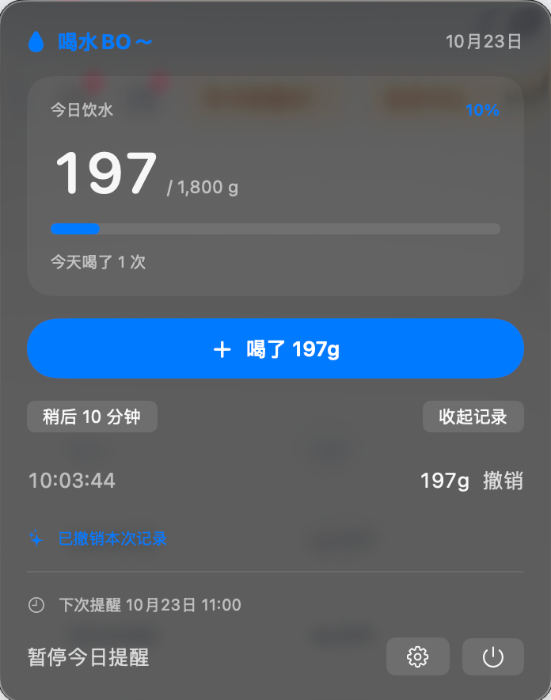
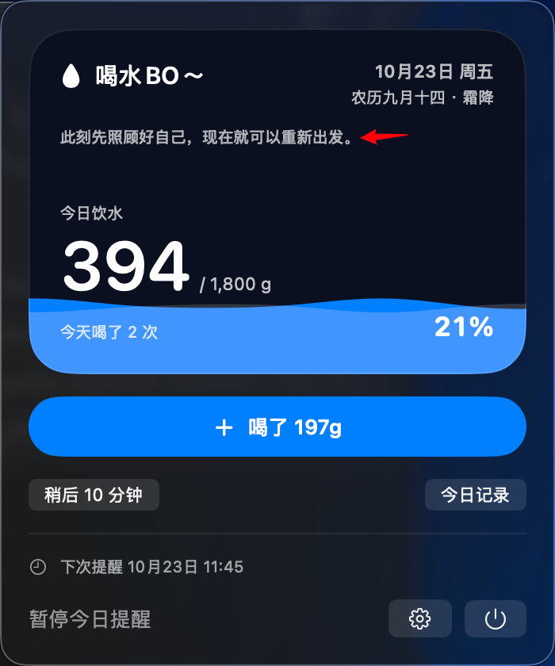
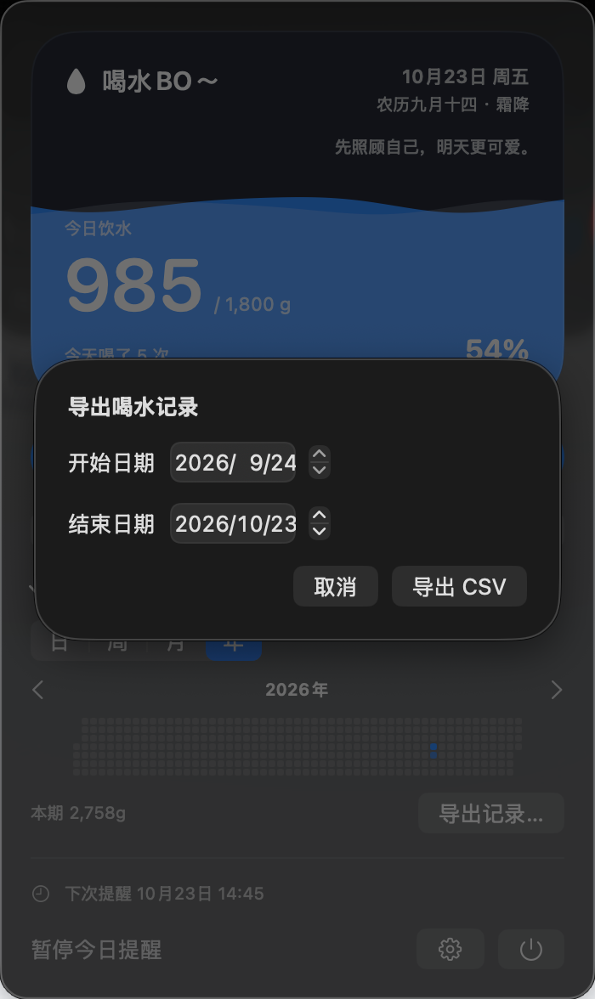

# 我做了一个 Mac 喝水小工具，结果最折腾的是那一层水波

一开始，我只是想在电脑上做个提醒喝水的小软件。要求也很简单：待在 Mac 菜单栏里，到点发个系统通知，喝完水能顺手记一下。不要为了喝口水，还得打开一个大软件。

后来我跟 Codex 一边聊一边做，才发现“简单”只是开始说得简单。我每用一会儿，就会冒出一个新想法：菜单栏能不能直接显示百分比？数字能不能跟电池电量一样亮？喝完一杯点一下，能不能真的有一点水涨起来的感觉？

这个小东西现在叫「喝水BO～」。名字后面那个“～”不是手滑，真的是名字的一部分。

我先量了自己的杯子，一杯大概 197 ml，所以按钮默认就是“喝了 197 ml”。每天的 1800 ml 也是我给自己设的目标，不是说每个人都该照着喝。杯量和目标都能改。工作日和周末的作息不一样，提醒时间、间隔也能分别调；我默认设在 11 点到 19 点。

刚做出来时，界面其实长这样：

*最早就是数字加一根进度条。能用，但看着总觉得少了点什么。图里还是旧版的 g 单位。*

我盯着那根蓝条看了几次，突然觉得：既然是喝水，为什么只有一根“任务进度条”？能不能把整个深色区域当成一只杯子，喝得越多，里面的水就越高？

想法说出来很轻巧，做出来却改了好多轮。第一版的蓝色我不喜欢，水波太硬；换了颜色，右边又没贴齐边框；水面动得太整齐，看起来像一整块蓝色塑料。后来把前后两层波纹的速度和起伏错开一点，才慢慢有了水在流动的感觉。现在连波纹高度、速度和两层颜色都可以自己调——毕竟有人喜欢活泼一点，有人可能只想它安静地待着。

*后来改成了整张水位卡片。这也不是最终截图，图中的单位后来统一改成了 ml。*

还有一些很小、但我自己很在意的地方。比如百分比后面原来有一块黑色的底，我看着不舒服，就去掉了。右上角的日期加了星期、农历和节气，旁边放一句每天会换的短句；句子太长会挤，就把它们缩短。主按钮的蓝色我最后定成了 `#0080FF`。

我还想要一点点“喝到了”的反馈：点击记录时，水慢慢涨；第一次跨过当天目标的 60%、80%、100%，会有越来越热闹的彩带。这里也踩过坑。我自己试到 65%，发现彩带居然没出来。后来查到是撤销记录后，之前的庆祝标记没清干净。这个问题不自己点着用，光看界面根本发现不了。

用着用着，我又想看今天到底是什么时候喝的，而不是只知道“喝了 5 次”。所以今日记录里有每次点击的时间，点错了也能撤销。再往后，我想看看一周、一个月的习惯，就加了可以收起来的历史格子：喝得多的日子蓝一点，少的日子淡一点。需要细看时，可以选一段日期，把每次喝水的时间和容量导出成 CSV。

*历史和导出刚加上时的截图。当时还出现过“点取消，整个窗口都没了”的 bug。现在回看挺好笑，当时可一点也不好笑。*

隐私这件事，我也不想只写一句“安全”就算了。现在这个版本没有账号，不联网，不收集或上传喝水记录；数据留在这台 Mac 上。中途其实想过加天气，但那样就得碰定位和网络，最后我还是把天气去掉了。第一次打开也会告诉你：它其实在菜单栏里，先量好自己的杯子，再把杯量、目标和提醒时间调成适合自己的。否则一个没有 Dock 图标的软件，确实容易让人以为没打开成功。

它还会继续改。我现在回头看，最开始要的只是“提醒我喝水”，真正让我愿意一直用的，却是那些后来一点点磨出来的小地方：它别打扰我，数字一眼能看清，水波看着舒服，点错能撤销，记录也能带走。

我把它分享出来，也不是觉得一个小工具能解决什么大问题。只是希望和我一样经常坐在电脑前、忙起来就忘了喝水的人，能因为菜单栏里这颗小水滴，多想起来喝几口水。算是为大家的身体健康做一点点小事。

如果它真的帮到了你，点个赞让我知道就好。我也会继续把它改得更顺手。

---

发布前检查：上面三张都是开发过程截图，不代表当前完整界面；旧图里的 g 已改为 ml。公开发布前再确认截图中日期与记录是否适合展示。
